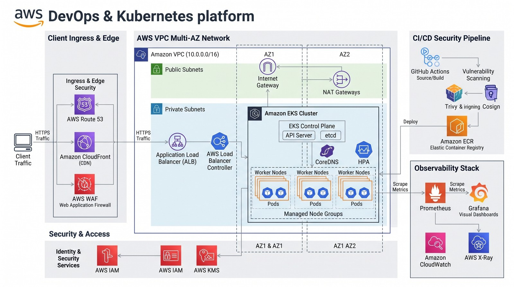

# :rocket: Cert-Manager Let's Encrypt Automation

<p align="center">
  
</p>

<div align="center">

[]()
[]()
[](LICENSE)
[](https://github.com/tayyabmasood911/cert-manager-letsencrypt-automation/pulls)
[]()

</div>

---

## :memo: Executive Summary

**Cert-Manager Let's Encrypt Automation** delivers a fully automated Public Key Infrastructure (PKI) and SSL/TLS certificate lifecycle management solution for Kubernetes clusters. Leveraging **cert-manager** and **Let's Encrypt ACME v2**, this implementation handles automatic certificate issuance, multi-tenant HTTP-01 challenge routing, DNS-01 wildcard domain verification, and zero-downtime certificate renewal 30 days prior to expiration.

Key operational outcomes:
- **Zero-Touch Certificate Lifecycle:** Eliminates human error and service disruptions caused by expired SSL/TLS certificates through automated issuance and rotation.
- **Wildcard & Multi-Domain PKI:** Supports multi-domain SANs and wildcard DNS-01 verification via Cloudflare API and AWS Route53.
- **Modern Cryptography:** Generates robust **ECDSA P-384** and RSA 4096-bit private keys with automatic key rotation on every renewal.
- **Ingress Controller Native Integration:** Automatically provisions TLS secrets upon Ingress resource declaration via Kubernetes annotations.

---

## :building_construction: System Architecture

The following diagram outlines the ACME challenge validation flow and automated TLS secret provisioning:

```text
+---------------------------------------------------------------------------------------------------+
|               Cert-Manager Automated TLS & Let's Encrypt PKI Architecture Blueprint              |
|                                                                                                   |
|   [Developer / GitOps CI/CD]                                                                      |
|               |                                                                                   |
|               v (Applies Ingress with annotation: cert-manager.io/cluster-issuer: letsencrypt-prod)|
|   [Kubernetes Ingress Resource]                                                                   |
|               |                                                                                   |
|               v (Triggers CertificateRequest & Order)                                             |
|   [cert-manager Controller] <========================> [Let's Encrypt ACME v2 Directory]          |
|               |                                         (Production / Staging Server)             |
|               +-----------------------+-----------------------+                                   |
|               | HTTP-01 Solver Path   | DNS-01 Solver Path    |                                   |
|               v                       v                       |                                   |
|   [NGINX Ingress Pods]        [Cloudflare / AWS Route53]      |                                   |
|   (.well-known/acme-challenge) (Automated TXT Record)         |                                   |
|               |                       |                       |                                   |
|               +-----------------------+-----------------------+                                   |
|                                       | (Challenge Verified)                                      |
|                                       v                                                           |
|                       [Signed X.509 Certificate]                                                  |
|                       (ECDSA P-384 / 90-Day Validity)                                             |
|                                       |                                                           |
|                                       v (Provisions / Updates)                                    |
|                       [Kubernetes TLS Secret: api-tls-cert]                                       |
|                       (Mounted by Ingress & Envoy for TLS 1.3 Termination)                        |
+---------------------------------------------------------------------------------------------------+
```

> High-resolution architectural vector diagram is available at [`docs/images/architecture.svg`](docs/images/architecture.svg).

---

## :sparkles: Key Enterprise Capabilities

- :white_check_mark: **Dual-Environment ClusterIssuers:** Pre-configured `letsencrypt-staging` (for validation and avoiding rate limits) and `letsencrypt-prod` (for trusted CA chains).
- :globe_with_meridians: **DNS-01 Wildcard Automation:** Ready-to-use manifests for wildcard domains (`*.company.internal`) via Cloudflare and AWS Route53 DNS providers.
- :repeat: **Proactive Renewal Engine:** Automatically triggers certificate renewals at 30 days (`renewBefore: 720h`) before expiration to prevent outages.
- :closed_lock_with_key: **Key Rotation Policy:** Enforces `rotationPolicy: Always` ensuring fresh cryptographic key pairs are generated on each certificate renewal.
- :electric_plug: **Seamless Ingress Binding:** Single-annotation integration (`cert-manager.io/cluster-issuer`) automatically generates and manages TLS secrets.
- :bar_chart: **Prometheus Telemetry & Alerting:** Native metrics export (`certmanager_certificate_expiration_timestamp_seconds`) enables alerting on renewal delays.

---

## :file_folder: Repository Directory Structure

```text
.
|-- .github/
|   `-- workflows/
|       `-- ci.yml                   # Automated validation CI pipeline
|-- config/
|   `-- production.env.example       # Baseline production environment variables
|-- docs/
|   `-- images/
|       |-- architecture-white.jpg   # High-resolution architectural overview
|       `-- architecture.svg         # Detailed vector topology blueprint
|-- scripts/
|   `-- healthcheck.sh               # Health check verification script
|-- tests/
|   `-- test_validation.py           # Integrity test suite
|-- certificate-wildcard.yaml        # Wildcard Certificate CRD with ECDSA P-384
|-- cluster-issuer.yaml              # HTTP-01 Let's Encrypt Staging and Production issuers
|-- dns01-issuer.yaml                # DNS-01 Cloudflare and Route53 ClusterIssuers
|-- ingress-tls.yaml                 # TLS-enabled Ingress manifest with auto-issuer
|-- .gitattributes                   # GitHub Linguist language overrides
|-- LICENSE                          # MIT License
|-- Makefile                         # Automation lifecycle targets
|-- README.md                        # Enterprise architectural documentation
`-- SECURITY.md                      # Security and vulnerability reporting policy
```

---

## :clipboard: Prerequisites

Ensure your operational environment satisfies the following baseline requirements:

| Component | Minimum Version | Description |
| :--- | :--- | :--- |
| **Kubernetes** | `>= 1.28.0` | EKS, GKE, AKS, or on-premise cluster |
| **cert-manager** | `>= 1.14.0` | Installed with Custom Resource Definitions (`cert-manager.crds.yaml`) |
| **Ingress Controller**| `>= 1.9.0` | NGINX, Traefik, or Envoy Ingress Controller supporting HTTP-01 |
| **kubectl** | `>= 1.28.0` | Standard Kubernetes command-line interface |
| **DNS Provider** | N/A | Cloudflare API Token or AWS Route53 Hosted Zone for DNS-01 |

---

## :zap: Quick Start & Deployment Guide

### 1. Install cert-manager via Helm
If cert-manager is not yet installed in your cluster:

```bash
helm repo add jetstack https://charts.jetstack.io
helm repo update
helm upgrade --install cert-manager jetstack/cert-manager \
    --namespace cert-manager \
    --create-namespace \
    --set crds.enabled=true
```

### 2. Deploy HTTP-01 ClusterIssuers
Deploy the Let's Encrypt Staging and Production ClusterIssuers:

```bash
# Remember to update the contact email address in cluster-issuer.yaml
kubectl apply -f cluster-issuer.yaml
```

### 3. Deploy DNS-01 Providers (For Wildcard Domains)
Create the DNS provider secret and apply the DNS-01 ClusterIssuer:

```bash
# Example Cloudflare API token secret
kubectl create secret generic cloudflare-api-token-secret \
    --namespace cert-manager \
    --from-literal=api-token="your-cloudflare-api-token" \
    --dry-run=client -o yaml | kubectl apply -f -

# Deploy DNS-01 issuers
kubectl apply -f dns01-issuer.yaml

# Issue wildcard certificate
kubectl apply -f certificate-wildcard.yaml
```

### 4. Deploy Secure TLS Ingress
Deploy the application ingress with automatic certificate issuance:

```bash
kubectl apply -f ingress-tls.yaml
```

### 5. Verify Certificate Status & ACME Orders
Check the status of certificate issuance, challenge pods, and TLS secrets:

```bash
# Inspect certificate issuance status and expiration dates
kubectl get certificate -A

# Check cert-manager Order and Challenge objects
kubectl get orders,challenges -A

# Validate the generated TLS secret
kubectl describe secret api-tls-cert
```

---

## :gear: Configuration Reference

| Parameter | Type | Default | Description |
| :--- | :--- | :--- | :--- |
| `acme.server` (Prod) | string | `https://acme-v02.api.letsencrypt.org/directory` | Production Let's Encrypt ACME endpoint |
| `acme.server` (Staging) | string | `https://acme-staging-v02.api.letsencrypt.org/directory` | Non-rate-limited staging ACME endpoint |
| `duration` | duration | `2160h` (90 days) | Total validity period of generated certificates |
| `renewBefore` | duration | `720h` (30 days) | Proactive renewal threshold before expiration |
| `privateKey.algorithm` | string | `ECDSA` | Elliptic curve cryptography algorithm |
| `privateKey.size` | integer | `384` | Cryptographic key size (P-384 curve) |
| `rotationPolicy` | string | `Always` | Forces new private key generation on renewal |

---

## :lock: Security, Compliance & Governance

1. **Automated Expiration Elimination:** Proactive 30-day renewal cycle eliminates zero-day certificate expiration outages.
2. **Modern Cipher Suites:** Mandates TLS 1.3 protocol and strong ECDSA cryptographic keys for data in-transit protection.
3. **Decoupled DNS Tokens:** Cloudflare and Route53 credentials are restricted by RBAC to the `cert-manager` namespace.
4. **Audit & Compliance:** Meets PCI-DSS Req 4 (encrypt transmission of cardholder data) and SOC 2 Type II controls.

---

## :bust_in_silhouette: Author & Maintainer

**Tayyab Masood**  
Cloud Solutions Architect & Senior DevOps Engineer  
- :globe_with_meridians: **GitHub:** [@tayyabmasood911](https://github.com/tayyabmasood911)  
- :email: **Email:** tayyabmasood911@gmail.com  
- :scroll: **Certification:** AWS Certified Solutions Architect - Associate  

---

## :page_facing_up: License

This project is licensed under the **MIT License** - see the [LICENSE](LICENSE) file for details.
